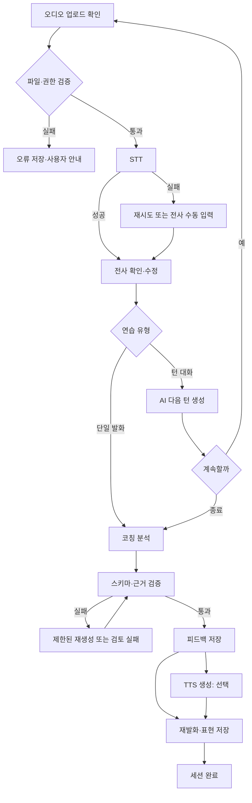

# OPIc + 일상 영어 회화 AI 코칭 모바일 앱 PRD v1.0

- 문서 상태: 구현 기준안
- 작성일: 2026-10-24 (Asia/Seoul)
- 대상: iOS·Android 모바일 앱, Expo/React Native + FastAPI + Supabase
- 제품 언어: 한국어 UI, 영어 발화·학습 콘텐츠

> **출처 범위**: 참조 대화에서 확인된 것은 사용자 확정 기능 14개와 기술 방향이다. 이전 assistant의 상세 PRD 본문은 참조 표식만 반환되어 확인할 수 없었다. 아래의 수치·세부 정책·화면 구성은 구현 가능한 v1.0 기준으로 새로 명시한 제안값이다. 실제 사용자 조사와 공급자 계약 후 조정한다.

## 1. 제품 목표와 성공 기준

사용자가 OPIc 질문에 답하는 능력과 실제 생활에서 영어로 대화를 이어 가는 능력을 함께 키운다. 사용자는 짧게 말하고, 본인의 발화를 듣고, 근거 있는 교정을 받은 뒤, 다시 말하고, 배운 표현을 복습한다. OPIc 모드는 시험형 답변의 구성과 전달을 돕는다. 일상 회화 모드는 상황에 맞는 반응과 대화 지속을 돕는다.

**핵심 반복 과정**: 시나리오 선택 → 발화 또는 대화 → 전사 확인 → 분석 → 개선 예시와 음성 듣기 → 다시 말하기 → 표현 저장·복습.

**출시 후 측정할 지표**: 가입자 중 첫 연습 완료율, 첫 세션에서 교정 후 재발화율, 7일 재방문율, 세션당 완료한 발화 수, 저장 표현의 7일 복습률, 분석 실패율, 음성 세션 중단율. 목표치는 베타의 2주 기준선을 본 뒤 확정한다. 사용자의 실제 영어 실력 향상은 별도 사람 평가 전후 비교로 확인한다.

**범위 밖**: 공식 OPIc 등급 보증, 시험 문제 복제 또는 시험 기관 제휴 주장, 사람 튜터, 소셜 피드, 결제·구독, 오프라인 AI 분석, 자유로운 텍스트 채팅. 실시간 음성 대화는 확정 범위에 포함하되 6번째 스프린트에서 출시 게이트를 통과해야 한다.

## 2. 대상 사용자와 핵심 시나리오

| 사용자 | 필요 | 완료 상태 |
|---|---|---|
| OPIc 준비자 | 주제별 답변을 구성하고 시간 안에 말하기 | 답변·교정·재발화·비공식 예상 수준 확인 |
| 회화 입문·중급자 | 익숙한 상황에서 문장을 이어 말하기 | AI와 여러 턴 대화하고 표현을 저장·복습 |
| 바쁜 학습자 | 5~10분의 짧은 연습 | 중단해도 이력이 남고 다시 시작 가능 |

## 3. 확정 기능 14개와 기능 요구사항

| ID | 기능 | 필수 동작 및 예외 | 완료 기준 |
|---|---|---|---|
| F01 | 마이크 녹음·재생 | 권한 요청, 시작·일시정지·종료, 파형 또는 시간 표시, 본인 녹음 재생, 재녹음. 권한 거부 시 설정 안내 | 권한 거부·무음·중단·재녹음 상태가 동작 |
| F02 | 영어 STT | 녹음 종료 후 영어 전사, 전사 원문 표시, 사용자 수정본 별도 저장. 불확실·빈 전사는 재시도 안내 | 원본·수정본 구분, 실패 시 재시도 가능 |
| F03 | LLM 분석·개선 가이드 | 발화 내용에 근거한 잘한 점, 우선 교정 1~3개, 자연스러운 예문, 다음 연습 제안. JSON 스키마 검증 | 근거 없는 단정과 민감한 추론 배제, 실패 시 재분석 |
| F04 | AI 음성 가이드 | 개선 예문과 AI 답변의 TTS 재생, 속도 조절, AI 생성 음성 고지 | 텍스트로도 같은 핵심 내용 제공 |
| F05 | 분석 이력 | 모드·상황·날짜별 세션 목록과 상세, 삭제 | 다른 사용자의 이력 접근 불가 |
| F06 | 로그인 | Supabase Auth 기반 이메일 로그인 우선, 세션 복원·로그아웃·비밀번호 복구 | 인증 만료 시 안전한 재로그인 |
| F07 | 분석 결과 공유 | 텍스트/이미지 공유 카드 미리보기, 사용자가 선택한 내용만 OS 공유 시트로 전송 | 기본값에서 원본 음성·이름·이메일 제외 |
| F08 | OPIc / 일상 회화 모드 | 홈에서 두 모드 명확히 선택, 모드별 안내·평가 기준 분리 | 한 모드의 평가를 다른 모드에 섞지 않음 |
| F09 | 질문·상황 시나리오 | OPIc 주제 질문 및 일상 상황 카드, 난이도·태그, 시작 전 목표 설명 | 콘텐츠 ID와 버전 기록, 빈 목록 대응 |
| F10 | 턴 기반 AI 영어 대화 | 사용자 녹음 종료 → STT → AI 다음 발화 생성 → 텍스트/음성 제공. 턴 수 상한 설정 | 중복 요청에도 한 턴만 저장, 종료·재개 가능 |
| F11 | 교정 후 다시 말하기 | 이전 문장과 교정 포인트 표시 후 재녹음, 1차/2차 나란히 비교 | 재발화는 원본을 덮어쓰지 않음 |
| F12 | 표현 저장·복습 | 교정 예문 또는 표현 저장, 상황·뜻·예문 표시, 복습 완료/다시 보기 | 중복 저장 방지, 삭제·복습 상태 반영 |
| F13 | OPIc 예상 등급 추정 | 충분한 샘플이 있을 때만 **비공식 연습 추정치**와 불확실성·근거 제시 | 공식 점수 아님을 항상 표시, 데이터 부족 시 미표시 |
| F14 | 실시간 음성 대화 | 통화형 AI 대화, 연결·말하는 중·끊김·종료 상태, 대화 후 요약 | 권한·네트워크·네이티브 연결 검증, 장애 시 턴 기반 경로 안내 |

### 공통 동작 규칙

- 연습 세션은 `draft → recording → processing → feedback_ready → completed`로 진행한다. 실패는 `failed`와 단계별 오류 코드로 남긴다.
- 사용자가 전사를 고쳐도 원본 전사를 보존하고 평가·코칭은 원본 전사를 기준으로 한다. 수정본은 음성 인식 오류 확인용으로 구분하며, 원본 평가와 섞지 않는다.
- AI 응답은 학습 보조 자료다. 문법·내용·발음 평가에 불확실성이 있으면 설명한다.
- 짧거나 무음인 녹음에는 점수나 등급을 부여하지 않는다.
- 앱은 한국어 설명과 영어 예문을 제공한다. 학습자 수준 설정은 시작 시 선택 가능하며 이후 수정 가능하다.

## 4. 화면별 사용자 흐름

| 화면 | 진입과 주요 행동 | 다음 화면·오류 |
|---|---|---|
| 시작/로그인 | 목적·개인정보 안내 → 회원가입/로그인 → 마이크 권한은 실제 사용 직전 요청 | 홈; 인증 오류·비밀번호 복구 |
| 홈 | OPIc·일상 회화 선택, 최근 연습, 표현 복습 진입 | 시나리오 목록·이력·설정 |
| 시나리오 목록 | 모드·난이도·주제 필터, 목표/예상 시간 확인 | 연습 준비; 콘텐츠 없음 안내 |
| 연습 준비 | 질문 또는 역할·상황 확인, 턴 기반/실시간 선택 가능 시 선택 | 녹음/턴 대화/실시간 통화 |
| 녹음 | 녹음·정지·재생·재녹음·제출 | 처리 화면; 권한 거부·무음·업로드 실패 |
| 턴 대화 | 사용자 발화 → 전사 확인 → AI 응답 읽기/듣기 → 다음 턴 또는 종료 | 분석 결과; 턴 생성 실패 시 재시도 |
| 실시간 통화 | 연결 → 대화 → 종료, 통화 시간·마이크 상태 표시 | 종료 후 요약; 끊김 시 복구/턴 기반 전환 |
| 분석 결과 | 원본/수정 전사, 우수점, 교정, 개선 예문, 평가 근거, 음성 듣기 | 다시 말하기·표현 저장·공유·이력 |
| 다시 말하기 | 교정 문장을 참고해 재발화, 전후 비교 | 결과 화면; STT 실패 시 재시도 |
| 이력 상세 | 이전 녹음·전사·교정·재발화·공유 | 결과 화면; 삭제 확인 |
| 표현함 | 저장 표현 목록, 뜻·예문, 복습 완료/다시 보기 | 홈; 삭제 확인 |
| 설정 | 계정, 데이터 보관/삭제, 음성 옵션, AI 음성 고지, 로그아웃 | 홈/로그인 |

## 5. 기술 구조

```text
Expo / React Native (iOS·Android)
  ├─ Supabase Auth: 로그인·세션
  ├─ HTTPS FastAPI: 세션/콘텐츠/평가/공유/실시간 세션 제어
  └─ 오디오 업로드: FastAPI가 발급한 제한된 업로드 경로 또는 API 스트리밍
           ↓
FastAPI: JWT 검증, 소유권 확인, 요청 제한, 작업 상태, 공급자 어댑터
  ├─ STT provider → 영어 전사
  ├─ LLM provider → 대화·구조화된 코칭·추정치
  ├─ TTS provider → AI 음성
  ├─ Realtime provider → 짧은 수명의 클라이언트 자격 또는 서버 중계
  └─ Supabase Postgres + private Storage (원본 음성·생성 음성)
```

- 앱은 Expo Router, TypeScript, `expo-audio`, 상태 관리와 서버 데이터 캐시를 사용한다. 패키지 버전은 구현 시작 시 현재 Expo SDK 호환성에 맞춰 고정하고 lockfile을 커밋한다. `expo-audio`는 공식 녹음·재생 API를 제공한다. [Expo Audio](https://docs.expo.dev/versions/v55.0.0/sdk/audio/)
- FastAPI가 제품 API의 단일 진입점이다. Supabase JWT의 서명·만료·대상을 검증하고 `user_id`를 요청 본문 대신 토큰에서 가져온다. 공급자 비밀키와 Supabase secret/service role 키는 서버에만 둔다.
- Postgres는 사용자·콘텐츠·세션·턴·평가·표현 메타데이터를 저장한다. Storage의 원본/생성 음성 버킷은 비공개로 유지한다. 사용자 재생에는 소유권 검증 뒤 짧은 수명의 접근을 발급한다. [Supabase RLS](https://supabase.com/docs/guides/database/postgres/row-level-security), [Storage private bucket](https://supabase.com/docs/guides/storage/serving/downloads)
- 실시간 음성은 공급자가 모바일 WebRTC/SDK를 지원하는지 첫 구현 전에 검증한다. Expo Go에서 지원되지 않는 네이티브 모듈이 필요하면 development build를 사용한다. 클라이언트에 장기 API 키를 넣지 않는다. OpenAI 경로를 선택할 경우 공식 WebRTC 문서의 서버 발급 단기 자격 흐름을 따른다. [OpenAI WebRTC](https://developers.openai.com/api/docs/guides/voice-webrtc?voice-api=realtime)

### 공급자 설정 계약

**S2 전사 공급자 결정(2026-10-25)**: Google Cloud Vertex AI의 `gemini-3.5-transcribe`를 사용한다. `speakloop-512602` 프로젝트에서 Agent Platform API를 사용 설정했다. 실제 녹음은 사용자가 제출할 때 비공개 Supabase Storage에 저장하고, 서버가 전사 요청 시 Vertex AI에 보낸다. 모델의 사용량은 과금될 수 있다. 이 계정의 무료 체험 크레딧 잔액은 현재 권한으로 확인하지 못했으므로 무료라고 표시하지 않는다. 서버 인증은 운영 환경에서 ADC/워크로드 ID 연동을 우선하고, 테스트용 API 키를 쓸 때는 서버의 비밀 환경 변수 `GOOGLE_API_KEY`에만 둔다. 앱에 키를 넣지 않는다. [모델 문서](https://docs.cloud.google.com/gemini-enterprise-agent-platform/models/gemini/3-5-transcribe), [가격](https://cloud.google.com/gemini-enterprise-agent-platform/generative-ai/pricing), [데이터 처리](https://docs.cloud.google.com/gemini-enterprise-agent-platform/resources/zero-data-retention)

환경 변수 예: `STT_PROVIDER`, `STT_MODEL`, `LLM_PROVIDER`, `LLM_MODEL`, `TTS_PROVIDER`, `TTS_MODEL`, `TTS_VOICE`, `REALTIME_PROVIDER`, `REALTIME_MODEL`. 각 어댑터는 `transcribe(audio)`, `coach(context)`, `synthesize(text)`, `create_realtime_session(options)` 인터페이스를 구현한다. 모델명은 배포 환경에서 선택하고 운영 시작 시 지원 상태·가격·지역·품질을 확인한다. 특정 모델 문자열을 제품 계약이나 DB enum에 넣지 않는다.

**모델 검증 결과(2026-10-24 확인)**: OpenAI 공식 모델 페이지는 `gpt-4o-mini-tts`에 Deprecated를 표시한다. 따라서 이 모델을 기본값으로 고정하지 않는다. 공식 TTS·전사·실시간 문서에 기능 경로가 있어도 모델의 수명 주기와 계정별 가용성은 별도로 확인한다. [모델 상태](https://developers.openai.com/api/docs/models/gpt-4o-mini-tts), [TTS](https://developers.openai.com/api/docs/guides/text-to-speech), [STT](https://developers.openai.com/api/docs/guides/speech-to-text), [Deprecated 목록](https://developers.openai.com/api/docs/deprecations)

### 처리 경로

1. **녹음형 분석**: 앱 녹음 → 임시 파일 검증 → 비공개 저장 → `POST /sessions/{id}/utterances` → STT → 사용자 전사 확인/수정 → `POST /sessions/{id}/analysis` → 구조화 결과 저장 → 요청 시 TTS 생성/캐시. 분석은 녹음 완료 후 실행한다.
2. **턴 기반 대화**: 사용자 턴 저장 → STT/전사 확인 → 이전 턴과 시나리오를 LLM에 전달 → AI 텍스트 저장 → 선택적으로 TTS 생성 → 다음 사용자 턴. 턴 수·토큰·비용 상한을 서버에서 적용한다.
3. **실시간 통화**: 인증된 앱이 FastAPI에 세션 생성 요청 → 서버가 공급자 세션/단기 자격 발급 → 앱과 공급자가 실시간 연결 → 서버가 종료·사용량·요약을 기록. 원본 통화 녹음은 별도 동의 없이는 저장하지 않는다. 공급자 transcript가 제공되어도 정확성을 가정하지 않고 요약 근거로 표시한다.
4. **장애 처리**: STT·LLM·TTS 단계별 재시도와 멱등성 키를 둔다. TTS 실패는 텍스트 결과를 막지 않는다. 실시간 연결 실패는 턴 기반 연습으로 이어진다.

## 6. API 명세 v1

공통: `/v1` 접두사, `Authorization: Bearer <Supabase access token>`, JSON 응답, UTC ISO 8601 시각, UUID 식별자. 대용량 오디오는 허용 형식·길이·크기를 서버에서 검사한다. 쓰기 요청에는 `Idempotency-Key`를 지원한다. 오류 형식은 `{ "error": { "code": "...", "message": "...", "request_id": "..." } }`이다. 서버가 인증·소유권을 검사하고 실패 시 401/403/404를 구분한다.

| 메서드·경로 | 요청 핵심 필드 | 응답 핵심 필드 | 동작 |
|---|---|---|---|
| `GET /v1/me` | 없음 | `id, settings` | 프로필 조회 |
| `PATCH /v1/me/settings` | `level, voice_speed, retention_choice` | 갱신 설정 | 설정 수정 |
| `DELETE /v1/me` | 재인증/확인 토큰 | `deletion_job_id` | 계정과 데이터 삭제 작업 시작 |
| `GET /v1/scenarios?mode=&level=&cursor=` | 필터 | `items, next_cursor` | 시나리오 목록 |
| `GET /v1/scenarios/{id}` | 없음 | `prompt, goals, version` | 질문·상황 상세 |
| `POST /v1/sessions` | `mode, scenario_id, interaction_type` | `id, status` | 연습 시작 |
| `GET /v1/sessions?cursor=` | 없음 | `items, next_cursor` | 이력 |
| `GET /v1/sessions/{id}` | 없음 | 세션·턴·분석 요약 | 상세 |
| `DELETE /v1/sessions/{id}` | 없음 | 204 | 세션과 연관 데이터 삭제 예약 |
| `POST /v1/sessions/{id}/uploads` | `mime_type, size_bytes, duration_ms, checksum` | `upload_id, upload_url, expires_at` | 제한된 오디오 업로드 경로 발급 |
| `POST /v1/sessions/{id}/utterances` | `upload_id, turn_index, is_retry` | `utterance_id, transcript_status` | 업로드 확정·STT 시작 |
| `GET /v1/utterances/{id}` | 없음 | `transcript_raw, transcript_edited, status` | STT 상태 확인 |
| `PATCH /v1/utterances/{id}/transcript` | `text` | 수정 전사 | 사용자 수정 |
| `POST /v1/sessions/{id}/next-turn` | `utterance_id` | `turn_id, ai_text, audio_status` | 다음 AI 턴 생성 |
| `POST /v1/sessions/{id}/analysis` | `utterance_id` 또는 완료 세션 | `analysis_id, status` | 코칭 작업 시작 |
| `GET /v1/analyses/{id}` | 없음 | 구조화된 피드백·상태·추정치 | 결과 조회 |
| `POST /v1/audio-guides` | `source_type, source_id, speed` | `audio_id, status` | TTS 생성 |
| `GET /v1/audio-guides/{id}` | 없음 | `status, playback_url, expires_at` | 재생 접근 |
| `POST /v1/expressions` | `source_analysis_id, text, meaning` | 표현 | 저장 |
| `GET /v1/expressions?due_only=&cursor=` | 없음 | 표현 목록 | 복습 |
| `PATCH /v1/expressions/{id}` | `review_result` | `next_review_at` | 복습 결과 |
| `DELETE /v1/expressions/{id}` | 없음 | 204 | 삭제 |
| `POST /v1/shares/preview` | `analysis_id, included_fields` | `preview` | 공유 전 확인 |
| `POST /v1/realtime/sessions` | `scenario_id, mode` | `session_id, client_token, expires_at, connection_config` | 단기 통화 자격 |
| `POST /v1/realtime/sessions/{id}/end` | `reason, duration_ms` | `summary_status` | 통화 종료 |

`POST /analysis`, STT, TTS 등 긴 작업은 202와 상태 조회를 사용한다. 클라이언트는 제한된 간격의 폴링을 하고 앱이 백그라운드로 가면 복귀 시 상태를 다시 읽는다. 공급자 오류를 원문 그대로 사용자에게 노출하지 않는다.

### 대표 분석 응답

```json
{
  "id": "uuid",
  "status": "ready",
  "mode": "daily",
  "transcript": {"raw": "...", "edited": null},
  "strengths": [{"text": "핵심 상황을 설명했습니다.", "evidence": "..."}],
  "improvements": [{"category": "grammar", "original": "...", "suggestion": "...", "reason_ko": "...", "priority": 1}],
  "improved_answer": "...",
  "next_practice": "...",
  "confidence": "medium",
  "opic_estimate": null,
  "rubric_version": "1.0"
}
```

## 7. 데이터 모델과 관계

| 테이블 | 주요 필드 | 관계·제약 |
|---|---|---|
| `profiles` | `id PK = auth.users.id`, `level`, `settings`, `created_at` | 사용자 1:1; 사용자 설정만 허용 |
| `scenarios` | `id`, `mode`, `level`, `title`, `prompt`, `goals`, `version`, `active` | 운영 콘텐츠; 세션이 버전 참조 |
| `sessions` | `id`, `user_id`, `scenario_id`, `scenario_version`, `mode`, `interaction_type`, `status`, `started_at`, `ended_at` | 사용자 1:N, 시나리오 1:N |
| `turns` | `id`, `session_id`, `seq`, `speaker`, `text`, `audio_path`, `created_at` | 세션 1:N; `(session_id, seq)` 유일 |
| `utterances` | `id`, `session_id`, `turn_id`, `parent_utterance_id`, `audio_path`, `duration_ms`, `transcript_raw`, `transcript_edited`, `stt_status` | 재발화는 `parent_utterance_id`로 연결 |
| `analyses` | `id`, `session_id`, `utterance_id`, `rubric_version`, `feedback_json`, `status`, `provider_trace_id`, `created_at` | 세션/발화 1:N; 평가 재실행 보존 |
| `grade_estimates` | `id`, `analysis_id`, `sample_count`, `label`, `confidence`, `reasons_json` | 분석 0:1; 비공식 추정 |
| `expressions` | `id`, `user_id`, `source_analysis_id`, `text`, `meaning`, `next_review_at`, `review_count` | 사용자 1:N; 정규화 표현 중복 제어 |
| `review_events` | `id`, `expression_id`, `user_id`, `result`, `created_at` | 표현 1:N |
| `audio_assets` | `id`, `owner_id`, `bucket`, `path`, `kind`, `mime_type`, `size_bytes`, `expires_at` | 저장 파일 메타데이터; 소유권 검사 |
| `realtime_calls` | `id`, `session_id`, `provider_session_ref`, `status`, `duration_ms`, `summary_json` | 세션 0:N; 토큰 원문 저장 금지 |
| `jobs` | `id`, `user_id`, `kind`, `resource_id`, `status`, `error_code`, `attempt_count` | 장기 작업 상태·재시도 |

모든 사용자 데이터는 `user_id` 또는 소유한 상위 레코드로 접근을 제한한다. 공개 스키마 테이블은 RLS와 최소 GRANT를 함께 설정한다. `auth.uid() = user_id`를 기본으로 하되 자식 테이블은 상위 세션의 소유권을 검증한다. UPDATE에는 `USING`과 `WITH CHECK`를 둔다. 서비스 권한은 서버의 통제된 경로에서만 사용한다. Storage 경로 예: `user_id/session_id/asset_id`. 삭제 작업은 DB 참조와 Storage 파일을 함께 처리한다. [Supabase RLS](https://supabase.com/docs/guides/database/postgres/row-level-security), [Storage 접근 제어](https://supabase.com/docs/guides/storage/security/access-control)

## 8. 코칭·평가 기준

### OPIc 연습 분석

- 관찰 항목: 질문 적합성, 답변 구성(시작·근거·예시·마무리), 상세성, 시제·문법, 어휘 다양성, 연결 표현, 자연스러운 전달, 발화 지속성.
- 각 항목은 1~5의 **내부 코칭 점수**와 짧은 증거를 기록한다. 근거는 실제 전사나 관찰 가능한 오디오 정보로 제한한다. 오디오 분석 능력이 없는 공급자 조합에서는 발음·억양 점수를 만들지 않는다.
- 예상 등급은 충분한 발화량과 다양한 질문 세션이 쌓였을 때만 표시한다. 초기 기준안은 서로 다른 OPIc 시나리오 3개 이상, 각 45초 이상의 유효 발화, 총 180초 이상이다. 이 기준은 검증 전 가설이다.
- 예상 등급은 규칙과 모델 출력을 결합한 비공식 범위/수준 설명으로 제공한다. 사람 평가와의 일치도 검증 전에는 공식 등급 표기를 좁게 단정하지 않는다. 화면마다 “공식 OPIc 성적이 아닌 연습용 추정”을 표시한다.

### 일상 회화 분석

- 관찰 항목: 상황 적합성, 의사 전달, 질문·후속 반응, 자연스러운 표현, 문법·어휘, 대화 지속.
- 사용자가 답을 이어 갈 수 있도록 한 번에 우선 교정 1~3개만 준다. 의미가 통했으면 불필요한 교정을 줄인다.
- 재발화 비교는 의미 전달과 핵심 교정 적용 여부를 설명한다. “실력이 향상됐다”는 장기 판단을 한 번의 재발화로 내리지 않는다.

### 평가 품질 게이트

- 고정된 한국어 설명/영어 예문 JSON 스키마를 검증한다. 필수 필드 누락·허위 인용·사용자 발화에 없는 내용은 거부 후 재생성한다.
- 익명화된 샘플을 사람 검토자가 채점해 정확성, 유용성, 친절성, 과잉 교정, 편향을 확인한다. 베타 출시 기준안: 치명적인 허위 근거 0건, 구조화 응답 유효율 99% 이상, 검토자 유용성 4/5 이상. 표본 수와 세부 평가지표는 스프린트 4에서 확정한다.

## 9. 비기능 요구사항과 운영

- **성능 목표(베타 가설)**: 60초 이내 녹음의 STT+분석 p95 20초 이하, TTS 생성 p95 10초 이하, 실시간 첫 응답 p95 3초 이하. 측정 조건(기기·네트워크·공급자)을 기록한다.
- **안정성**: 작업 중복 실행 방지, 단계별 timeout, 지수 백오프, 실패한 단계만 재시도. 공급자 장애 시 사용자에게 저장된 세션과 재시도 방법 표시.
- **접근성**: 텍스트 크기, 화면 읽기 레이블, 색상 외 상태 표시, 음성 내용의 텍스트 대체, 재생 속도 조절.
- **관찰성**: 요청 ID·작업 ID·공급자·지연 시간·오류 코드·비용 추정 기록. 원본 음성·전사·토큰·비밀키는 일반 로그에서 제외.
- **비용 제어**: 사용자별 하루 연습량/실시간 분 제한, 공급자별 월 예산 경고, 긴 대화 요약, TTS 캐시. 한도에 닿으면 이유와 재사용 가능한 학습 경로 안내.

## 10. 개인정보·보안

1. 녹음·전사·분석은 개인정보로 취급한다. 녹음 화면에서 처리 목적과 AI 공급자 전송을 한국어로 알린다. 마이크 권한은 기기 녹음에 사용하고, 서버 업로드는 사용자가 **녹음 제출·영어 전사**를 누를 때 시작한다. 매 세션 동의 버튼은 두지 않는다. 보관 기간·삭제 방법과 별도 동의 기록의 필요 여부는 출시 전 법률·운영 검토로 확정한다.
2. **기본 보관 정책 제안**: 원본 음성 30일, 생성 음성 30일, 전사·분석 이력은 계정이 유지되는 동안 보관. 사용자가 세션을 삭제하면 연결된 DB/Storage 자료를 삭제 작업으로 처리한다. 확정 전 법률·운영 검토가 필요하다.
3. 공유는 명시적 선택이다. 미리보기에서 포함할 항목을 고르고 OS 공유 시트를 연다. 서버의 공개 URL을 만들지 않는 방식을 기본으로 한다.
4. HTTPS 전송, 비공개 Storage, RLS·소유권 검사, 서버 비밀키 관리, 짧은 수명의 음성 접근 URL, 업로드 형식/크기/길이 제한, 악성 파일 검사 경로를 둔다. signed URL은 만료 전 회수가 쉽지 않으므로 짧게 발급한다. [Storage signed URL](https://supabase.com/docs/guides/storage/serving/downloads)
5. 실시간 통화 원본은 기본 저장하지 않는다. 대화 요약/전사 저장 범위를 사용자가 확인한다. 공급자의 보관·처리 정책과 데이터 지역을 출시 전 검토한다.
6. AI 생성 음성임을 재생 화면과 시작 안내에 명확히 표시한다. [OpenAI TTS 고지 요건](https://developers.openai.com/api/docs/guides/text-to-speech)
7. 앱·API에 민감 정보 마스킹, 인증 실패 제한, 속도 제한, 감사 로그를 적용한다. 계정 삭제 후 남는 백업 데이터의 제거 기한도 운영 정책에 명시한다.

## 11. 하네스 엔지니어링: 실행·평가·회귀 검증

하네스는 AI 기능을 **같은 입력으로 재현하고, 결과를 판정하고, 배포를 막거나 허용하는 실행 환경**이다. 앱의 사용자 코드와 분리해 `evals/`에 둔다. 공급자를 바꾸거나 프롬프트를 고쳐도 같은 사례와 기준으로 비교한다. 평가 플랫폼의 특정 제품명이나 API에 종속되지 않는다. OpenAI 공식 문서는 추적 기록과 데이터셋·평가를 함께 사용해 에이전트 동작을 살피도록 설명한다. 기존 Evals 플랫폼은 종료 일정이 공지되어 있으므로 새 구현의 필수 의존성으로 두지 않는다. [에이전트 평가](https://developers.openai.com/api/docs/guides/agent-evals), [Evals 전환 안내](https://developers.openai.com/api/docs/guides/evals)

### 하네스 구성

| 구성 | 구현 계약 | 검증 결과 |
|---|---|---|
| 사례 집합 | `case_id`, 모드, 시나리오, 익명화 전사/오디오 샘플, 예상 관찰, 금지 출력, 난이도·억양 태그 | 동일 사례 반복 실행 |
| 공급자 어댑터 | 실제 공급자와 결정적 fake를 같은 인터페이스로 호출 | 단위·통합 테스트 경계 일치 |
| 실행 기록 | `run_id`, 사례/루브릭/프롬프트/모델/어댑터 버전, 지연·비용·오류 코드 | 변경 전후 추적 |
| 구조 검증 | JSON 스키마, 필드 타입, 근거 인용, 모드 일치, 길이 제한 | 자동 통과/실패 |
| 품질 채점 | 사람이 표시한 기준 답변과 루브릭을 바탕으로 정확성·유용성·과잉 교정·편향 평가 | 항목별 점수와 실패 사유 |
| 장애 주입 | 무음, 불완전 STT, 공급자 429/5xx, 지연, 중복 요청, 통화 끊김 | 복구와 중복 방지 확인 |
| 보고서 | 이전 승인 실행과 점수·비용·지연 비교, 실패 사례 링크 | 배포 판단 자료 |

사례 집합은 개발용 합성 데이터로 시작하고, 사용자가 명시적으로 품질 개선에 동의한 자료만 별도 익명화·검토를 거쳐 추가한다. 원본 음성과 개인정보는 일반 CI에 넣지 않는다. 음성 평가용 별도 안전 저장소가 필요하면 접근 권한과 보관 기한을 분리한다. OPIc/일상 회화, 초급/중급, 짧은/긴 발화, 강한 억양, 무음·잡음, 위험한 요청을 균형 있게 포함한다.

### 단계별 검증과 배포 게이트

1. **PR 검증**: fake 공급자로 상태 전이·API 계약·RLS·멱등성 테스트와 소형 텍스트 평가 집합 실행. 비밀키 없이 재현 가능해야 한다.
2. **야간 검증**: 승인된 공급자 설정으로 대표 STT→분석→TTS 경로와 비용·지연 측정. 결과는 버전별로 보존한다.
3. **모델/프롬프트 변경 전**: 동일 평가 집합을 현재 운영 설정과 후보 설정에 실행한다. 치명 오류 0건, JSON 유효율 99% 이상, 사람 평가 핵심 지표의 의미 있는 하락 없음, 비용·p95 지연 한도 준수를 확인한다.
4. **출시 후**: 실패·재시도·이탈 지표를 수집하고, 개인정보가 제거된 사례를 검토해 평가 집합에 반영한다. 채점기 자체도 사람 판정과 정기적으로 비교한다.

하네스는 모델의 문장 유사도 하나로 품질을 결정하지 않는다. 같은 의미의 다양한 좋은 답변을 허용한다. AI 채점은 보조 수단이며 OPIc 예상 수준은 별도 사람 평가로 검증한다. 각 실패는 `case_id`, 단계, 기대 조건, 실제 결과를 남겨 재현한다.

## 12. 루프 엔지니어링: 사용자 학습과 시스템 개선

### 사용자 학습 루프

```text
목표 선택 → 첫 발화 → 전사 확인 → 핵심 교정 1~3개 → 개선 예문 듣기
      → 다시 말하기 → 전후 비교 → 표현 저장 → 간격 복습 → 다음 상황
```

- **시작 신호**: 모드·시나리오·학습자 수준. OPIc와 일상 회화의 루브릭을 따로 적용한다.
- **한 회전의 산출물**: 원본 발화, 사용자 확인 전사, 교정 근거, 재발화, 적용한 교정 항목. 결과는 세션에 연결한다.
- **피드백 우선순위**: 의미를 막는 오류 → 상황에 맞지 않는 표현 → 반복되는 문법/어휘 → 세련된 표현. 한 번에 다 고치지 않는다.
- **진행 판단**: 같은 학습 목표의 여러 세션에서 재발화 적용률·대화 지속·복습 성공을 함께 본다. 한 번의 발화에 장기 실력 향상 문구를 쓰지 않는다.
- **종료 조건**: 사용자 종료, 턴·시간·비용 상한, 반복 오류, 네트워크 이탈. 중단된 세션은 복구하거나 완료 상태를 명확히 표시한다.
- **안전한 복습**: 저장 표현은 복습 결과에 따라 다음 날짜를 조절한다. 복습 알림은 별도 사용자 동의 전에는 보내지 않는다.

### 시스템 개선 루프

```text
익명 집계·사용자 신고 → 실패 유형 분류 → 사례/루브릭 보강
      → 후보 프롬프트·모델·라우팅 변경 → 하네스 비교 → 제한 배포
      → 운영 관찰 → 유지 또는 되돌리기
```

개선의 단위는 프롬프트만이 아니다. STT 품질, 전사 수정 UX, 시나리오, 코칭 루브릭, TTS 속도, 비용 라우팅을 각각 바꿀 수 있다. 한 번에 한 축씩 변경하고 버전과 결과를 남긴다. 실시간 개인 음성으로 모델을 자동 재학습하거나, 사용자별 점수를 자동 보정하지 않는다. 공급자 변경은 동의·보관 정책 검토와 하네스 검증을 거친다.

**루프 지표**: 첫 세션 완료율, 교정 후 재발화율, 교정 적용률, 7일 표현 복습률, 세션당 유효 대화 턴 수, 사용자 신고율, STT 수정률, 분석 재시도율. 앱 이벤트에는 학습 콘텐츠 원문 대신 ID와 집계값을 우선 남긴다. 각 지표는 OPIc/일상 회화와 사용자 수준별로 나눠 해석한다.

## 13. 그래프 엔지니어링: 작업 흐름과 상태 전이

이 제품의 그래프는 사용자의 대화를 무한히 자율 실행하는 에이전트가 아니라, **서버가 통제하는 유한한 작업 그래프**다. 각 노드는 입력·출력 스키마, timeout, 재시도 정책, 멱등성 키, 오류 코드를 가진다. 조건 분기와 종료가 명시되어야 한다. FastAPI 서비스 계층과 `jobs` 테이블로 먼저 구현하고, 처리량·복구 요구가 커질 때만 별도 워크플로 엔진을 검토한다.



### 노드 계약과 복구

| 노드 | 입력 → 출력 | 실패 시 처리 |
|---|---|---|
| `validate_audio` | 업로드 ID·소유권 → 검증된 자산 | 파일 거부, 사용자에게 재녹음 안내 |
| `transcribe` | 자산·언어 → 원본 전사·신뢰 정보 | 제한 재시도; 빈 결과는 수동 입력/재녹음 |
| `confirm_transcript` | 원본·사용자 수정 → 확정 전사 | 사용자 대기; 원본 유지 |
| `generate_turn` | 시나리오·이전 턴·확정 전사 → AI 텍스트 | 동일 요청 재실행 시 기존 턴 반환 |
| `analyze` | 모드·루브릭·확정 전사 → 피드백 JSON | 공급자 오류 재시도, 초과 시 실패 상태 |
| `validate_feedback` | 피드백·원문 → 유효성 결과 | 최대 1회 재생성 후 명시적 실패 |
| `synthesize` | 승인된 텍스트 → 생성 음성 | 텍스트 피드백은 계속 사용 |
| `complete` | 모든 필수 노드 상태 → 완료 세션 | 중복 완료 방지 |

`jobs`에 `node`, `input_hash`, `attempt_count`, `status`, `lease_until`, `error_code`, `started_at`, `finished_at`를 추가한다. 각 노드는 `session_id + node + input_hash`로 중복 실행을 막는다. 외부 공급자 호출은 무조건 재시도하지 않는다. 429/일시 오류에만 제한된 백오프를 적용하고, 동일 요청을 여러 번 과금할 수 있는 경우에는 공급자 idempotency 지원 여부를 확인한다. 작업 재시작은 마지막 성공 노드 다음부터 진행한다. 취소·계정 삭제 시 대기 작업을 중단하고 생성 파일 정리를 수행한다.

실시간 통화는 위 비동기 그래프와 별개로 `created → connecting → active → reconnecting → ended/failed` 상태 기계를 가진다. 통화 종료 후 요약·분석을 비동기 그래프에 넘긴다. 재연결 횟수와 시간을 제한한다. 오디오·이벤트 순서가 뒤바뀌어도 서버의 세션 버전 또는 순번 검사로 중복 저장을 막는다. 각 노드의 추적에는 원문 대신 ID·상태·지연·공급자 오류 범주를 기록한다. 단계별 추적은 장애 원인을 파악하고 평가 사례를 만들 때 사용한다. [OpenAI 추적 개념](https://developers.openai.com/api/docs/guides/agents-api/tracing)

## 14. 6개 스프린트 계획과 인수 기준

**플랫폼 우선순위(2026-10-26)**: Android를 먼저 개발·실기기 검증·배포한다. iOS 구현은 유지하되 iOS 실기기 인수 테스트는 추후 진행한다.

각 스프린트는 2주를 가정한다. 기간은 팀 규모에 맞게 조정한다. 매 스프린트 끝에 iOS·Android 실제 기기에서 주요 흐름을 확인한다.

| 스프린트 | 개발 범위 | Acceptance criteria |
|---|---|---|
| S1 기반 | 저장소 구조, Expo 앱, FastAPI, Supabase Auth·마이그레이션·RLS, 로그인/홈/모드, 상태 그래프·하네스 골격 | 로그인·로그아웃·세션 복원 동작; A 사용자가 B 데이터에 접근 시 403/404; 비밀키가 앱 번들에 없음; fake 공급자로 상태 전이 재현 |
| S2 녹음·STT | 시나리오, 녹음·재생, 비공개 업로드, STT, 전사 수정, 오디오 장애 사례 | iOS·Android에서 녹음/재생; 권한 거부·무음·업로드 실패 처리; 수정 전사와 원본 보존; 무음·중복 업로드 회귀 검증 |
| S3 코칭 | LLM 구조화 분석, 결과 화면, TTS 가이드, 분석 이력, 평가 사례 집합 | 모드별 피드백 JSON 검증; 녹음 종료 후 분석; TTS 실패 시 텍스트 사용; 이력 재열람·삭제; 이전 승인 결과와 품질 비교 |
| S4 학습 루프 | 턴 기반 대화, 다시 말하기, 표현 저장·복습, 평가 품질 검토, 학습 루프 지표 | 여러 턴 순서 유지; 중복 제출에도 중복 턴 없음; 재발화 전후 비교; 복습 일정 갱신; 품질 표본 검토; 모드별 루프 지표 집계 |
| S5 OPIc·공유 | OPIc 평가 루브릭, 비공식 예상 수준, 공유 카드, 개인정보 설정, 후보 변경 평가 게이트 | 데이터 부족 시 등급 미표시; 모든 추정 화면에 비공식 고지; 공유 미리보기의 선택 필드만 전송; 삭제 작업 확인; 모델·프롬프트 변경 시 하네스 비교 |
| S6 실시간·출시 | 실시간 음성 연결, 중단 복구, 비용 제한, 그래프·하네스 운영 계측, 성능·보안 점검, 배포 | 네이티브 iOS·Android 통화 검증; 끊김 시 턴 기반 전환; 시간·비용 상한 적용; 장애 주입과 회귀 평가 통과; 필수 성능·보안 게이트 통과 |

### 출시 게이트

- 14개 기능의 수동 인수 시나리오가 두 플랫폼에서 통과한다.
- 하네스의 소형 회귀 집합과 전체 대표 집합을 통과하고, 그래프 장애 주입 시 복구·종료 상태가 정확하다.
- 인증·RLS·Storage에 대해 타 계정 접근 차단을 자동 테스트한다.
- 녹음 → STT → 분석 → TTS → 재발화 → 이력 흐름이 실제 공급자로 통과한다.
- 실시간 통화가 개발 빌드와 배포 빌드 모두에서 연결·종료·중단 복구된다. 실패하면 전체 출시 일정을 조정하고 해당 기능 상태를 명확히 고지한다.
- 데이터 삭제가 DB와 Storage에 반영되고, 민감한 내용이 일반 로그·공유 기본값에 포함되지 않는다.

## 15. Codex 구현 지침

1. 이 문서를 제품 요구사항의 기준으로 사용한다. 먼저 현재 저장소와 `AGENTS.md`를 확인하고 Expo SDK·Python·Supabase 버전을 고정한다.
2. `apps/mobile`, `apps/api`, `supabase/migrations`, `packages/contracts`, `docs` 구조를 기본으로 사용한다. 기존 저장소가 있으면 구조를 억지로 바꾸지 않는다.
3. API OpenAPI 스키마와 공통 JSON 계약을 먼저 정의한다. 프런트의 타입은 계약에서 생성하거나 동기화한다. 상태 전이는 서버에서 검증한다.
4. Supabase 마이그레이션에 PK/FK, cascade 정책, 인덱스, 최소 GRANT, RLS, Storage 정책을 포함한다. 사용자 간 교차 접근 테스트를 작성한다. Supabase 문서의 최신 설정을 구현 시 다시 확인한다.
5. STT·LLM·TTS·Realtime을 별도 어댑터와 설정으로 구현한다. 공급자 응답을 앱의 안정된 JSON 계약으로 변환한다. deprecated 모델을 코드에 기본값으로 넣지 않는다.
6. S1→S6 순서로 작은 단위로 구현한다. 각 단계에서 실제 기기와 실제 API의 핵심 사용자 흐름을 검증하고, 단순 내부 함수 모사만으로 완료 처리하지 않는다.
7. 프롬프트는 버전을 붙여 관리한다. 코칭 결과는 JSON 스키마를 검증하며 사용자 발화의 인용 근거와 루브릭 버전을 남긴다. 예상 등급은 실험 기능으로 표시한다.
8. `evals/`에 사례, 루브릭, 실행기, 비교 보고서 형식을 둔다. CI에서는 합성 데이터와 fake 공급자를 쓰고, 실제 공급자 검증은 승인된 환경에서 실행한다.
9. 처리 그래프 노드마다 입력/출력 스키마, 멱등성, timeout, 취소, 재시도 한도를 구현한다. 상태 전이와 장애 주입을 통합 테스트한다.
10. 사용자 학습 루프의 이벤트와 품질 지표를 모드별로 계측한다. 개인정보가 포함된 원문을 일반 분석 이벤트에 싣지 않는다.
11. 배포 전 현재 공급자 모델 상태, 요금, 처리 지역, 이용 제한, Expo 네이티브 지원, 개인정보 처리 조건을 다시 확인하고 운영 설정값을 확정한다.

## 16. 남은 제품 결정

- 로그인 방식 추가 여부(Apple/Google 등), 무료 사용량과 실시간 통화 한도.
- 원본 음성·전사 보관 기간, 계정 삭제 후 백업 제거 기한, 지원 국가와 개인정보 고지 문구.
- OPIc 예상 수준의 표시 방식과 사람 평가 검증 기준.
- 실시간 통화 공급자 및 모바일 SDK/WebRTC 경로. 공급자 선택 후 1개 기기당 연결·오디오 라우팅·중단 복구 시험이 필요하다.

이 결정은 제품 운영자가 승인할 항목이다. 구현은 설정값과 기능 플래그를 사용해 결정 전에도 진행할 수 있다.

## 17. 공식 참고 문서

- [OpenAI 모델 상태: GPT-4o Mini TTS](https://developers.openai.com/api/docs/models/gpt-4o-mini-tts)
- [OpenAI deprecated 안내](https://developers.openai.com/api/docs/deprecations)
- [OpenAI 음성 전사](https://developers.openai.com/api/docs/guides/speech-to-text)
- [OpenAI 음성 생성](https://developers.openai.com/api/docs/guides/text-to-speech)
- [OpenAI 실시간 WebRTC](https://developers.openai.com/api/docs/guides/voice-webrtc?voice-api=realtime)
- [Expo Audio](https://docs.expo.dev/versions/v55.0.0/sdk/audio/)
- [Supabase RLS](https://supabase.com/docs/guides/database/postgres/row-level-security)
- [Supabase Storage 비공개 파일 접근](https://supabase.com/docs/guides/storage/serving/downloads)
- [OpenAI 에이전트 평가](https://developers.openai.com/api/docs/guides/agent-evals)
- [OpenAI 평가 플랫폼 전환 안내](https://developers.openai.com/api/docs/guides/evals)
- [OpenAI 추적](https://developers.openai.com/api/docs/guides/agents-api/tracing)
